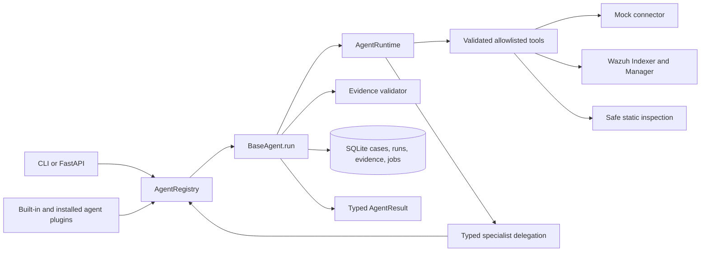

# Architecture

VIGIL is one deployable Python package. Four thin domain agents share the `BaseAgent` Template Method, `AgentRuntime`, typed Pydantic contracts, `ToolRegistry`, SQLite store, model manager, and telemetry abstraction.

Provider and connector dependencies use adapters. Agent modules never import provider SDKs or Wazuh HTTP details. Mock-to-Wazuh switching uses `VIGIL_CONNECTOR_MODE`, and per-agent model switching uses persisted nonsecret assignments.

The four built-in agent packages are loaded through `PluginManager`, using the same `AgentPlugin` contract available to separately installed extensions. Python package entry points under `vigil.agent_plugins` provide discovery. Plugins declare the shared services they require, are validated before registration, and cannot silently replace another agent ID. VIGIL does not download plugin code or hot-reload it at runtime.

SQLite enables WAL, foreign keys, indexes, migrations, durable job states, payload-bound idempotency keys, case-scoped memory, evidence, audit calls, and reports. Workers claim atomically with owner/expiry leases; only expired running jobs are recoverable, and retries are capped. SQLite remains a controlled single-node choice.

Security boundaries are enforced in Python: tool allowlists, Pydantic arguments, IP parsing, 30-day query windows, event limits, file roots, file sizes, symlink rejection, TLS verification by default, API authentication, and no execution/remediation tools.

